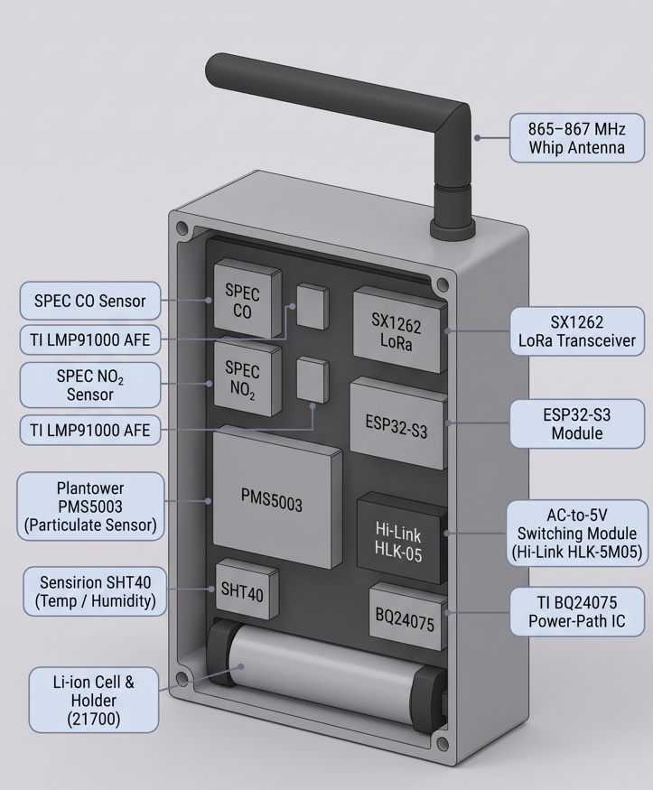
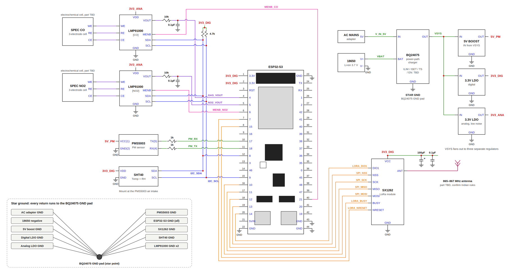

# AeroTrace: Edge-Computed Urban Air Quality Mesh Network
> **SEVA First Innovation Challenge 2026 | Team Vision.exe**

[](LICENSE)

---

## Overview: The AeroTrace Paradigm
Standard low-cost air quality sensors have a fatal flaw: during urban winter fog, high relative humidity causes optical scattering that laser counters misinterpret as extreme particulate pollution. Meanwhile, government-grade monitoring stations are highly accurate but too sparse and expensive to track street-level micro-emissions.

**AeroTrace fundamentally re-engineers environmental monitoring for dense urban wards. It is a 100% decentralized, edge-computed triage ecosystem.**

Instead of blindly streaming raw, unverified 1Hz data to a centralized cloud—draining power and bandwidth—AeroTrace buffers data in SRAM, applies localized environmental compensation, and transmits optimized JSON telemetry. Designed for zero-OpEx scalability, the node leverages Bluetooth Low Energy (BLE) for localized mobile diagnostics and a sub-GHz LoRa mesh for city-wide reporting.

### Core Engineering Pillars
- **Memory-Safe Edge Firmware:** Built entirely in C++ without standard Arduino `String` usage. Telemetry is constructed using strict `snprintf` bounds into fixed `char` arrays to eliminate heap fragmentation during months of continuous uptime.
- **Asynchronous Non-Blocking I/O:** Relies purely on `millis()` state machines. Hardware serial buffers (like the 32-byte PMS5003 optical frames) are continuously parsed with strict mathematical checksum validation without stalling the main loop.
- **Zero-Cloud Local Diagnostics:** Features a standalone vanilla HTML/JS dashboard utilizing the native Web Bluetooth API. It plots live ~2.5 Hz data streams directly to a browser via Chart.js, requiring zero cloud infrastructure for bench calibration.
- **Hardware-Isolated RF:** The SX1278 LoRa transceiver is physically wired but locked in hardware standby (NSS pulled HIGH) during BLE transmission to prevent SPI bus noise from corrupting sensitive analog ADC gas readings.

---

## Physical Prototype & Hardware Architecture
To ensure clean analog signal conditioning and prevent power-draw spikes from resetting the MCU, the hardware architecture is built around dedicated power-path management and isolated data buses.

- **UART2:** PMS5003 Optical Particulate Counter (Pins 16/17).
- **ADC1:** MQ-7 (CO) and MQ-135 (Air Quality) via resistor voltage dividers (Pins 32/33).
- **Custom Digital:** SHT10 Climate Sensor (Pins 21/22).
- **SPI Bus:** SX1278 LoRa Module (Pin 18 NSS).

### System Schematics & 3D Design
| 3D Enclosure Design | Circuit Schematic Diagram |
| :---: | :---: |
|  |  |

*(See the `/hardware` directory for the full Bill of Materials (BOM) and power-path failover documentation utilizing the TI BQ24075).*

---

## Architecture: MVP vs. Production Roadmap
We built a fully functional MVP using COTS components to validate the memory-safe firmware architecture and localized BLE dashboard. The roadmap scales this architecture into a highly calibrated, municipal-grade mesh network.

> **1. [ SENSE ]**
> * **MVP (Current):** Plantower PMS5003 (Particulates) | SHT10 (Climate) | MQ-7 & MQ-135 (Analog Gas).
> * **Production Vision:** Sensirion SPS30 (MCERTS-certified Particulates) | SHT40 (High-Precision Climate) | SPEC Electrochemical Sensors for sub-ppm CO/NO2 detection.

> **2. [ COMPUTE & POWER ]**
> * **MVP (Current):** ESP32 dual-core executing non-blocking bare-metal C++ loops with manual 12-bit ADC attenuation.
> * **Production Vision:** Ultra-low power STM32WL (Integrated LoRa SoC) to drop sleep currents from milliamps to microamps, powered by a ruggedized solar-harvesting IC.

> **3. [ CONNECTIVITY & MESH ]**
> * **MVP (Current):** High-frequency (2.5 Hz) Bluetooth Low Energy (GATT Nordic UART) for local dashboard visualization.
> * **Production Vision:** Active LoRaWAN mesh routing compressed telemetry to municipal gateways.

> **4. [ TELEMETRY DASHBOARD ]**
> * **Edge Interface:** Vanilla HTML/JS parsing chunked BLE byte streams into rolling Chart.js visualizations.
> * **Cloud Aggregation:** InfluxDB time-series database with a Grafana frontend for historical spatial mapping.

---

## Repository Structure & Quick Start

```text
Aero-Trace/
├── 📁 hardware/      # Schematics, BOM (₹8,500 target), and 3D CAD renders
├── 📁 firmware/      # ESP32 C++ source (v1 BLE testing sketch)
└── 📁 dashboard/     # Standalone Web Bluetooth HTML/JS dashboard
