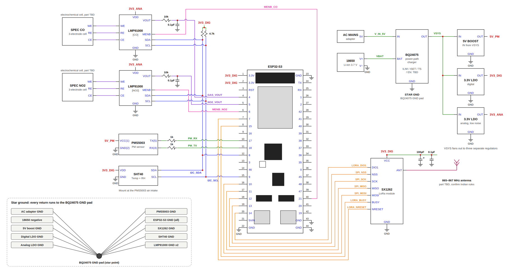
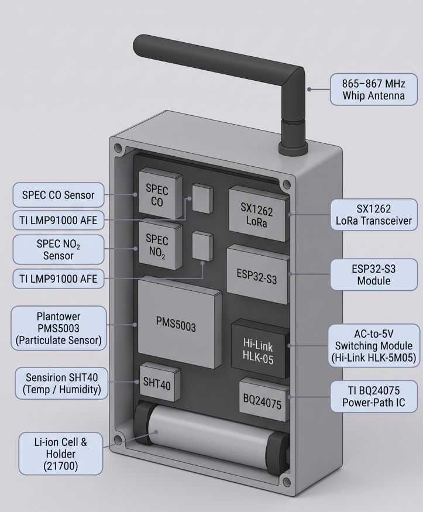

# AeroTrace Hardware & Subsystem Architecture

This directory holds the complete hardware architecture, schematics, 3D CAD design files, and the bill of materials for **AeroTrace**. 

We built this hardware stack to solve a very specific problem: low-cost air quality sensors are notorious for false readings during urban winter fog (high relative humidity), and standard government monitoring stations are too sparse to catch street-level micro-emissions. AeroTrace bridges this gap with an edge-computed, zero-OpEx node that runs localized humidity correction and streams reliable anomaly alerts.

---

## 1. System Schematic
Our circuit design is structured around isolated power domains, low-noise analog signal conditioning for electrochemical gas sensors, and an ESP32-S3 edge compute core.

### Key Circuit Design Choices:
- **Analog Front-End (AFE):** The SPEC CO and NO₂ electrochemical cells are paired with TI LMP91000 ICs, utilizing dedicated 3V3-ANA rails and 10 kΩ / 0.1 µF filters to eliminate high-frequency noise.
- **Power-Path Management:** The board uses a TI BQ24075 IC to handle simultaneous system loads and battery charging, paired with a Hi-Link HLK-5M05 AC-to-DC module to piggyback off municipal grid power (like streetlights). It automatically fails over to a 5000mAh 21700 Li-ion cell during grid dropouts.
- **Star Grounding:** To prevent ground loops between the high-current switching supplies and low-level analog sensors, all return lines route back to a single star-ground point at the BQ24075 GND pad.

---

## 2. Enclosure & Mechanical 3D Design
We designed a compact, vertical IP65-compliant (targeted) enclosure optimized for street-pole mounting, featuring dedicated airflow channels for the particulate and gas sensors.

- **Form Factor:** Vertical layout with internal M3 hex standoffs.
- **Component Placement:** Isolated thermal/air intake zones for the Plantower PMS5003 laser counter and Sensirion SHT40, keeping the microcontroller and power modules compartmentalized.
- **Telemetry:** Top-mounted hinged whip antenna connected to an SX1262 LoRa module operating on the 865–867 MHz WPC band for long-range, zero-OpEx star-network communication.

---

## 3. Bill of Materials (BOM)
The node is aggressively cost-optimized to enable dense spatial scaling across urban wards. You can inspect the full breakdown in [bill_of_materials.csv](./bill_of_materials.csv).

| Component | Function | Estimated Cost (INR) |
| :--- | :--- | :--- |
| **ESP32-S3** | Edge compute & SRAM anomaly buffering | ₹700 |
| **SX1262** | Zero-OpEx LoRa mesh transceiver | ₹500 |
| **PMS5003** | Particulate sensing (PM2.5 / PM10) | ₹1,400 |
| **SHT40** | Temperature + humidity compensation | ₹400 |
| **SPEC CO / NO₂** | Electrochemical combustion gas sensing | ₹4,000 |
| **LMP91000** | Ultra-low-noise gas signal conditioning (AFE) | ₹500 |
| **Battery + BQ24075 + PCB & IP65 Housing** | AC power-path management & Li-ion failover | ₹1,000 |
| **Total Node Cost** | **Fully functional edge-compute node** | **₹8,500** |
